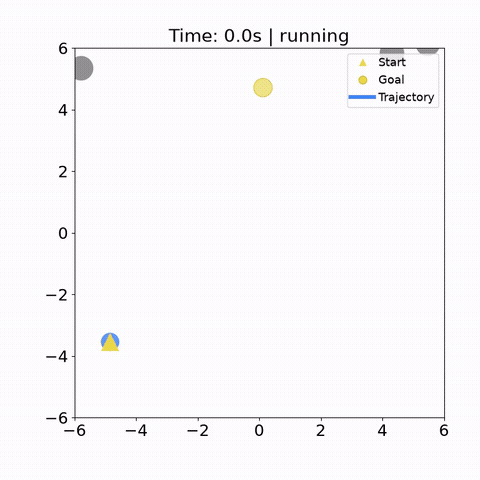
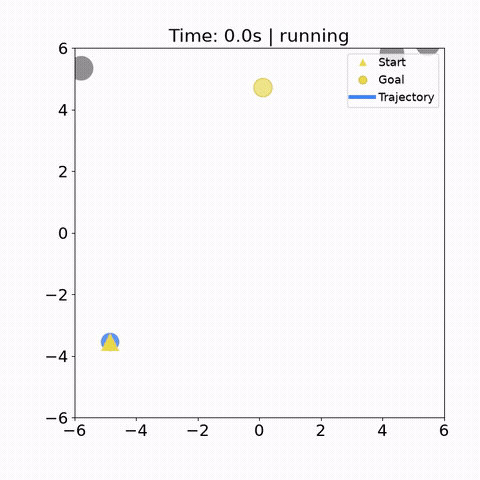
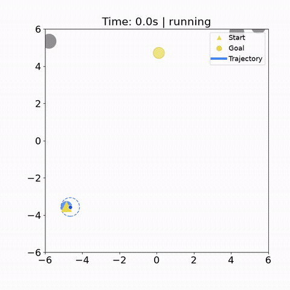
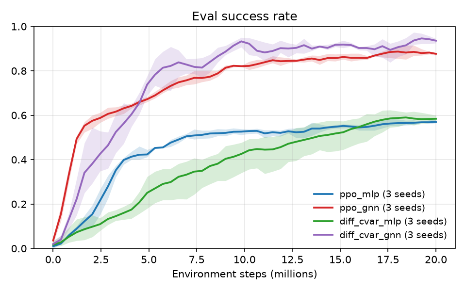
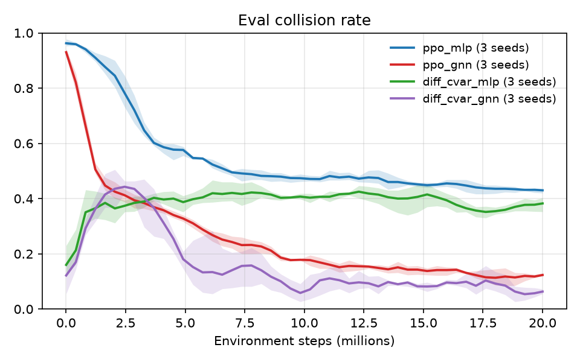
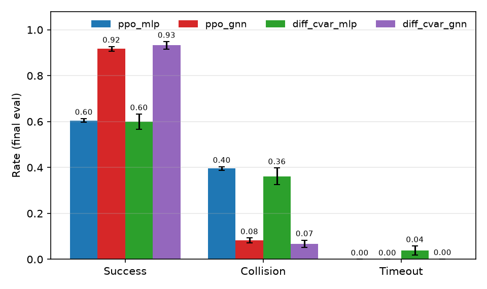
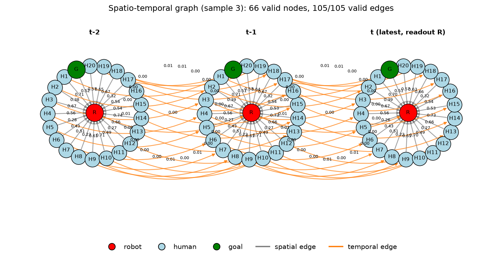

# Task 001: GNN Observation Encoder for DiffCVaR Crowd Navigation

Branch: `gnn-jax` (JAX). This branch replaces the MLP observation encoder with a spatio-temporal graph attention network (GAT), first for `ppo_mlp` (giving `ppo_gnn`) and then for `diff_cvar_mlp` (giving `diff_cvar_gnn`). All four models are trained and compared in the paper's 20-obstacle unicycle setting.

**Headline:** with the same environment, trainer settings and seeds, the GNN encoder raises final eval success from 0.60 to 0.92 for PPO (`ppo_mlp` to `ppo_gnn`) and from 0.60 to 0.93 for DiffCVaR (`diff_cvar_mlp` to `diff_cvar_gnn`). `diff_cvar_gnn` and `ppo_gnn` are tied within seed variation on success and collision, and `ppo_gnn` reaches the goal in about half the time (6.7 s vs 12.0 s).

## Contents

1. [Videos: same scenario, four policies](#videos-same-scenario-four-policies)
2. [Results](#results)
3. [Q1. Graph input](#q1-graph-input)
4. [Q2. GNN structure](#q2-gnn-structure)
5. [Q3. QP: differences from the original `main`](#q3-qp-differences-from-the-original-main)
6. [Q4. Reward](#q4-reward)
7. [Q5. Outputs and gradient flow](#q5-outputs-and-gradient-flow)
8. [Q6. Results table and videos](#q6-results-table-and-videos)
9. [Reproduce](#reproduce)

## Videos: same scenario, four policies

All four policies start from the same scenario (eval seed **323**, seed-0 training run). GIFs play at 2x speed.

| `ppo_mlp` | `ppo_gnn` | `diff_cvar_mlp` | `diff_cvar_gnn` |
|---|---|---|---|
|  |  |  |  |
| collision | collision | collision | success |


## Results

### Learning curves (3 seeds, mean line, min to max band)

| Success | Collision |
|---|---|
|  |  |

In-training eval uses 20 episodes per point, so each point has a standard error of about ±0.06 near 0.9. The final comparison below uses the larger `scripts/eval.py` evaluation.

### Final evaluation (`scripts/eval.py`, latest surviving checkpoint, 10 scenario seeds x 50 episodes)



| Model | Seeds | Success | Collision | Timeout | Return | Travel time (s) | Closest dist (m) |
|---|---|---|---|---|---|---|---|
| ppo_mlp | 3 | 0.60 ± 0.01 | 0.40 ± 0.01 | 0.00 ± 0.00 | 2.34 ± 0.05 | 6.2 ± 0.1 | 0.93 ± 0.02 |
| ppo_gnn | 3 | 0.92 ± 0.01 | 0.08 ± 0.01 | 0.00 ± 0.00 | 3.76 ± 0.05 | 6.7 ± 0.1 | 0.71 ± 0.02 |
| diff_cvar_mlp | 3 | 0.60 ± 0.03 | 0.36 ± 0.04 | 0.04 ± 0.02 | 1.25 ± 0.16 | 15.6 ± 0.5 | 0.67 ± 0.08 |
| diff_cvar_gnn | 3 | 0.93 ± 0.02 | 0.07 ± 0.02 | 0.00 ± 0.00 | 3.30 ± 0.07 | 12.0 ± 0.2 | 0.75 ± 0.01 |

Values are mean ± std over training seeds. Travel time and closest distance are over successful episodes only, so they are not directly comparable between models with very different success rates. Closest distance is the smallest clearance between the robot and human surfaces in an episode. Each run uses its latest surviving checkpoint: the trainer keeps the 10 checkpoints with the best in-training eval, so `ppo_mlp` seed 0 and `ppo_gnn` seed 1 use `ckpt_19660800` and the other runs use `ckpt_20000768`.

### In-training eval at 20M steps (W&B, mean over 3 seeds, range in brackets)

| Model | Success | Collision | Timeout |
|---|---|---|---|
| diff_cvar_gnn | 0.92 (0.91 to 0.94) | 0.07 (0.06 to 0.09) | ~0 |
| ppo_gnn | 0.88 (0.87 to 0.89) | 0.12 (0.11 to 0.13) | ~0 |
| diff_cvar PyTorch `main` (1 run, reference) | 0.82 | 0.17 | ~0 |
| diff_cvar_mlp (JAX) | 0.58 (0.57 to 0.59) | 0.38 (0.35 to 0.40) | 0.03 (0 to 0.07) |
| ppo_mlp | 0.57 (0.56 to 0.60) | 0.43 (0.40 to 0.45) | ~0 |

| Model | Success at 2M | 5M | 10M | 20M | First ≥ 0.8 |
|---|---|---|---|---|---|
| diff_cvar_gnn | 0.44 | 0.72 | 0.94 | 0.92 | ~6 to 9M |
| ppo_gnn | 0.57 | 0.67 | 0.81 | 0.88 | ~9M |
| diff_cvar_mlp (JAX) | 0.09 | 0.24 | 0.42 | 0.58 | not reached |
| ppo_mlp | 0.14 | 0.45 | 0.53 | 0.57 | not reached |

### QP diagnostics (late training)

| Quantity | diff_cvar_gnn | diff_cvar_mlp |
|---|---|---|
| r_safe mean (m) | 0.75 to 0.78 (at the 0.75 floor) | 0.87 to 1.05 |
| beta max / min over active humans | 0.19 to 0.27 / 0.05 to 0.06 | 0.30 (cap) / 0.05 (floor) |
| QP slack mean | ~0.01 | 0.05 to 0.10 |
| QP correction mean | 2.1 to 2.5 | 2.5 to 2.6 |

**Reading the results**
- `diff_cvar_gnn` and `ppo_gnn` are tied within seed variation in the final evaluation (success 0.93 ± 0.02 vs 0.92 ± 0.01, collision 0.07 ± 0.02 vs 0.08 ± 0.01). During training, `diff_cvar_gnn` is behind at 2M (0.44 vs 0.57) and ahead by 5M (0.72 vs 0.67).
- The MLP models fail mostly by collision, not timeout.
- In the final evaluation, the GNN adds 0.32 success to PPO and 0.33 to DiffCVaR.
- The QP has a clear time cost: successful episodes take 12.0 s vs 6.7 s on the GNN and 15.6 s vs 6.2 s on the MLP. The in-training collision gap between the two GNN models (0.07 vs 0.12) mostly disappears in the larger final evaluation.
- The MLP beta allocation saturates (one human at the cap, the rest at the floor). The GNN allocation is more graded.
- `ppo_gnn` has a higher return than `diff_cvar_gnn` (3.76 vs 3.30) despite similar success. Its shorter episodes explain part of this: about 53 fewer steps at the -0.0025 per-step penalty is worth about 0.13 of the 0.46 gap. The remaining cause was not measured. Closest distance does not point to more discomfort-zone penalties for `diff_cvar_gnn`, since its mean clearance is slightly larger (0.75 vs 0.71 m) and both are well above 0.25 m.


## Q1. Graph input

Code: [`model/jax_graph.py`](model/jax_graph.py) (`_graph_`, `_edge_index`).

**Raw observation.** One frame has 126 values for N = 20 humans: `[goal_rel(2), robot_vel(2), theta, robot_radius]` followed by 20 blocks `[rel_pos(2), vel(2), radius, mask]`. The policy gets the last T = 3 frames, oldest to newest, so `obs_dim = 378`. At episode start the first frame is repeated 3 times. The env uses rel = robot minus entity.

**Preprocessing.** All vectors in all frames are rotated into the **latest** robot body frame (one shared heading). Positions are divided by 20 m (`env.farthest_dist`), velocities by 1.5 m/s (`robot.v_max`).

**Nodes (66 = T x (N + 2)).** Per frame: robot, 20 humans, goal. Node id = `t*(N+2) + k`. Node features (4): one-hot type `[robot, goal, human]` plus a validity mask. Inactive humans stay in the graph and are masked, so the topology is static.

**Edges (105, each with 7 features `[dx, dy, dvx, dvy, dr, is_spatial, mask]`).**

| Edge | Direction | Count | Features |
|---|---|---|---|
| Spatial human | human(t) to robot(t) | 60 | relative position, `human_vel - robot_vel`, human radius, 1, human mask |
| Spatial goal | goal(t) to robot(t) | 3 | goal_rel, `-robot_vel`, 0, 1, 1 |
| Temporal robot | robot(t) to robot(t+1) | 2 | `-Δgoal_rel` (robot displacement), Δvelocity, Δradius, 0, 1 |
| Temporal human | human_i(t) to human_i(t+1) | 40 | `Δhuman_rel - Δgoal_rel` (robot ego-motion removed), Δvelocity, Δradius, 0, `mask_t * mask_t+1` |

History frames are **nodes**, so the GNN has to infer obstacle motion from the temporal edges. The graph is one sample; the batch is handled with `jax.vmap` over a shared `edge_index`.




## Q2. GNN structure

Code: [`model/jax_gat.py`](model/jax_gat.py), [`model/jax_ppo_gnn.py`](model/jax_ppo_gnn.py), [`model/jax_diff_cvar_gnn.py`](model/jax_diff_cvar_gnn.py). Config: [`config/model/ppo_gnn.yaml`](config/model/ppo_gnn.yaml), [`config/model/diff_cvar_gnn.yaml`](config/model/diff_cvar_gnn.yaml).

**Sparse GAT encoder** (edge list + `jax.ops.segment_*`, no dense N x N attention):

```
node encoder   Linear(4 → 64) + ReLU
3 x GAT layer  (layers = history_len)
  z    = [h_dst, h_src, e]                 135
  psi1 MLP 135 → 64 → 64                   edge embedding
  psi2 MLP 64 → 64 → 1                     attention logit
       masked softmax over incoming edges of each receiver
  psi3 MLP 64 → 64 → 64                    message
       agg = segment_sum(alpha * message)
  h    = h + MLP([h, agg]) 128 → 64 → 64   residual update
readout psi4   MLP 64 → 64 → 16 on the latest robot node (global latent)
```

Three layers are needed because the longest path, human at t = 0 to robot at t = 2, is 3 hops. Two layers do not reach it, four add nothing.

**Heads.**
- `ppo_gnn`: actor `16 → 256 → 256 → 2` (pre-tanh mean) + learned log-std. Critic `16 → 256 → 256 → 1`, sharing the GAT.
- `diff_cvar_gnn`: nominal head `16 → 256 → 256 → 2`. **Per-human heads** for beta and r_safe: input `[latent(16), human node state at the latest frame(64), latest human→robot edge features(5)] = 85 → 256 → 1` for each head, applied to all 20 humans. 

**Parameter counts.**

| Model | Params | Encoder |
|---|---|---|
| ppo_mlp | 170,329 | MLP 29,264 |
| ppo_gnn | 260,060 | GAT 118,995 |
| diff_cvar_mlp | 184,967 | MLP 29,264 |
| diff_cvar_gnn | 282,596 | GAT 118,995 |


## Q3. QP: differences from the original `main`

Code: [`model/jax_cvar_qp.py`](model/jax_cvar_qp.py), [`solver/jax_qpth`](solver/jax_qpth).

| | Original `main` (PyTorch) | This branch (JAX) |
|---|---|---|
| Variables | `u` only | `z = [u(2), s(5)]`, slack per CBF row |
| Objective | nominal tracking | `‖J u - nominal‖² + 10 ‖s‖²` (`qp_slack_weight = 10`) |
| CBF rows | hard | soft: `G u - s ≤ h`, `s ≥ 0` |
| Action bounds | stored, no box rows in the unicycle QP | box rows: v ∈ [-1.5, 1.5], ω ∈ [-1.57, 1.57] |
| Infeasibility | eval falls back to the previous action or zeros; no fallback in training | always feasible thanks to the slack |
| Risk level beta | one global beta ∈ [0.05, 0.1] | per human, budget 0.5 split over the top 5 by softmax, each ∈ [0.05, 0.30] |
| Safety margin | one global r_safe ∈ [0.8, 2.0] | per human, `r_robot + r_human + 0.05 + 1.125·sigmoid` ∈ [0.75, 1.875] |
| Nominal action | world frame | body frame, rotated by theta before the QP |
| Constraint set | | top-5 humans by distance from the raw current observation |

The QP receives the raw current-frame observation in the world frame, not the graph. Slack is rarely used by `diff_cvar_gnn` (mean ~0.01), but rare spikes (batch max 5 to 11 in seed 0 after 17M steps) show near-infeasible events still happen.

## Q4. Reward

Code: `reward_done` in [`env/jax_social_nav.py`](env/jax_social_nav.py). Unchanged from the original release.

| Term | Value |
|---|---|
| Success (within 0.6 m of goal) | +20 |
| Collision | -20 |
| Timeout (400 steps, dt = 0.1 s) | 0 |
| Discomfort (clearance < 0.25 m) | `(clearance - 0.25) * 10 * dt` |
| Progress (otherwise) | `3.0 * (prev_dist - dist)`, clipped to ±0.45 |
| Spin | `-4.5 (ω dt)²` |
| Reverse | `-0.1 * abs(v)` |
| Per step | `-0.025` |
| Boundary | `0.1 * violation` |

All terms are divided by 10. Robot radius 0.3 m, human radius 0.4 m, 20 humans.

## Q5. Outputs and gradient flow

**`ppo_gnn`.** The actor mean comes straight from the head on the GAT latent.

**`diff_cvar_gnn`.**

```
obs ─► graph ─► GAT ─► latent (16) ─► nominal head ─────────────┐
                  └──► human nodes (20 x 64) ─► beta, r_safe ───┤
raw current obs ─► top-5 humans, CBF rows ──────────────────────┤
                                                                ▼
                                                      QP ─► u* (pre-tanh Gaussian mean)
                                    sample a = u* + std·ε ─► env action = bias + scale·tanh(a)
```

- Gradient path: PPO loss → log-prob → `u*` → QP custom VJP (KKT implicit differentiation) → nominal action (through the linear term) and beta, r_safe (through `h`) → heads → GAT.
- Blocked: top-k indices, GMM parameters (`stop_gradient`), observation-derived QP data. Only the 5 selected humans' heads get gradient in a step.
- The critic also trains the GAT through the shared latent.
- Extra outputs: beta, r_safe, slack (diagnostics only).


## Q6. Results table and videos

The table is in [Final evaluation](#final-evaluation-scriptsevalpy-latest-surviving-checkpoint-10-scenario-seeds-x-50-episodes) and the videos are at the [top](#videos-same-scenario-four-policies).

**Settings (all runs).** 20 humans, unicycle, 20M steps, 128 envs, 4,096 steps per batch, 4 epochs, 32 minibatches, lr 1e-4 with linear decay, γ 0.99, λ 0.98, clip 0.2, entropy 0.01, target KL 0.02, max grad norm 0.5, normalized advantages. Training seeds 0, 1, 2.

**Checkpoints.** Stored under `outputs/crowd_dyn_var_num_env/runs/<model>_s<seed>-<model>-bs4096-ep4-lr1.0e-04-ent0.01-braxppo/`:

| Model | Seed 0 | Seed 1 | Seed 2 |
|---|---|---|---|
| `ppo_mlp` | `ckpt_19660800.pkl` | `ckpt_20000768.pkl` | `ckpt_20000768.pkl` |
| `ppo_gnn` | `ckpt_20000768.pkl` | `ckpt_19660800.pkl` | `ckpt_20000768.pkl` |
| `diff_cvar_mlp` | `ckpt_20000768.pkl` | `ckpt_20000768.pkl` | `ckpt_20000768.pkl` |
| `diff_cvar_gnn` | `ckpt_20000768.pkl` | `ckpt_20000768.pkl` | `ckpt_20000768.pkl` |


## Reproduce

```bash
# train all four models, seeds 0 1 2
for m in ppo_mlp ppo_gnn diff_cvar_mlp diff_cvar_gnn; do for s in 0 1 2; do
  WANDB_MODE=offline RUN_NAME=${m}_s${s} bash scripts/run_ppo.sh model=${m} seed=${s}; done; done

# final metrics on the latest surviving checkpoint of each run (writes eval_results.json)
python scripts/eval.py --save-dir <run_dir> --checkpoint <run_dir>/ckpt_<last>.pkl

# all 500 videos (saved to <run_dir>/visualize_ckpt_<step>/seed_<n>_<status>.mp4; includes seed 323)
python scripts/eval.py --save-dir <run_dir> --checkpoint <run_dir>/ckpt_<last>.pkl --visualize

# parity check against the PyTorch baseline (diff_cvar_mlp only)
RUN_NAME=diff_cvar_mlp_parity bash scripts/run_ppo.sh model=diff_cvar_mlp \
  trainer.timesteps_per_batch=8192 trainer.n_updates_per_iteration=8 \
  trainer.normalize_advantages=false trainer.num_envs=8
```

Install, W&B logging and general options are the same as the base JAX branch: see the `main_jax` README of the [original repo](https://github.com/anonymousrobotics9666/Reinforcement-Learning-Adaptive-CVaR-Barrier-Function).
