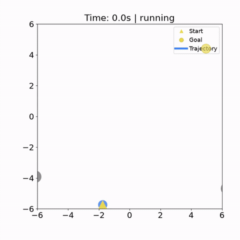
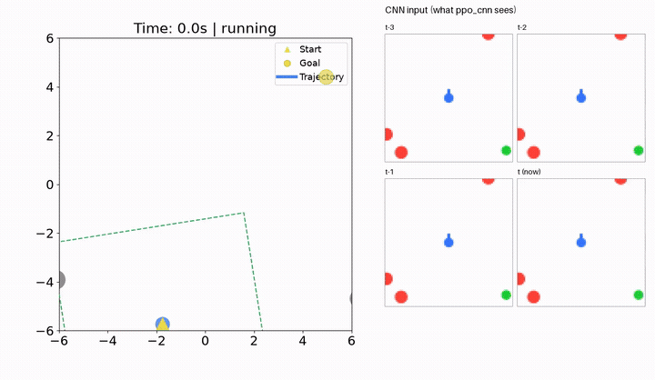
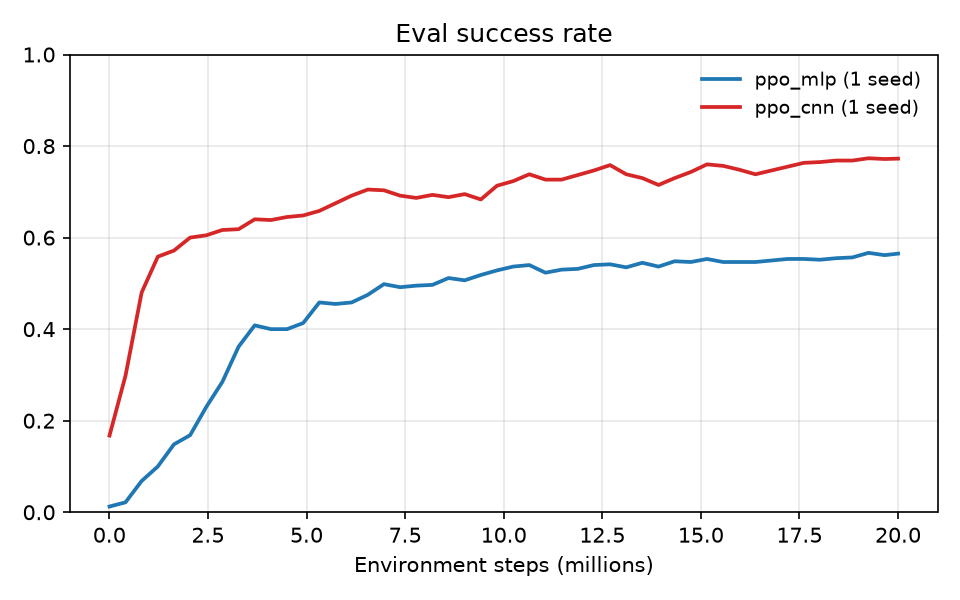
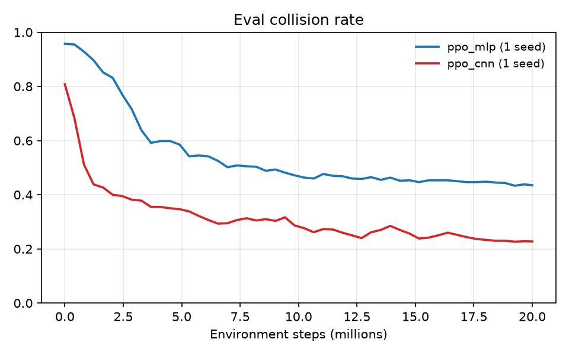
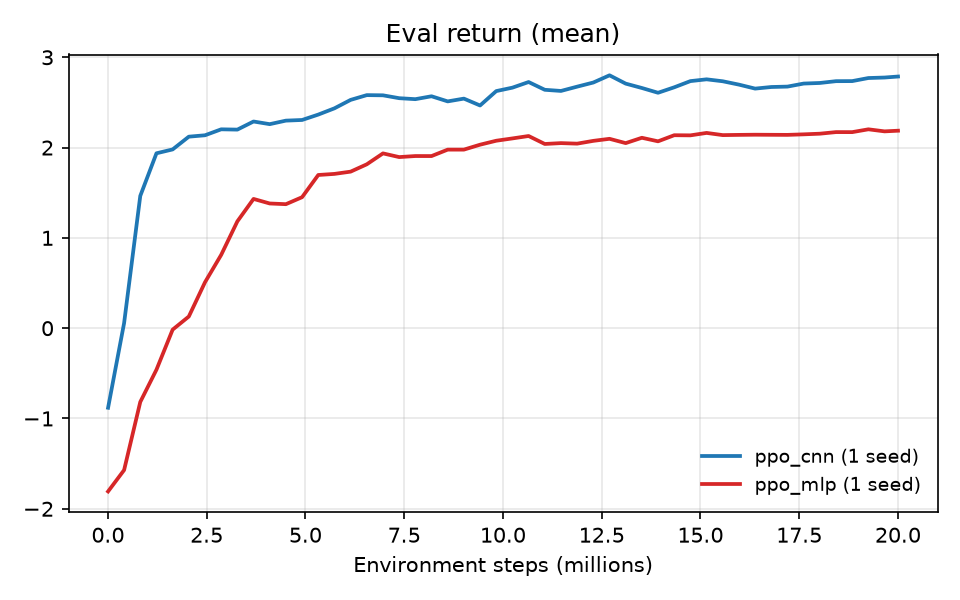
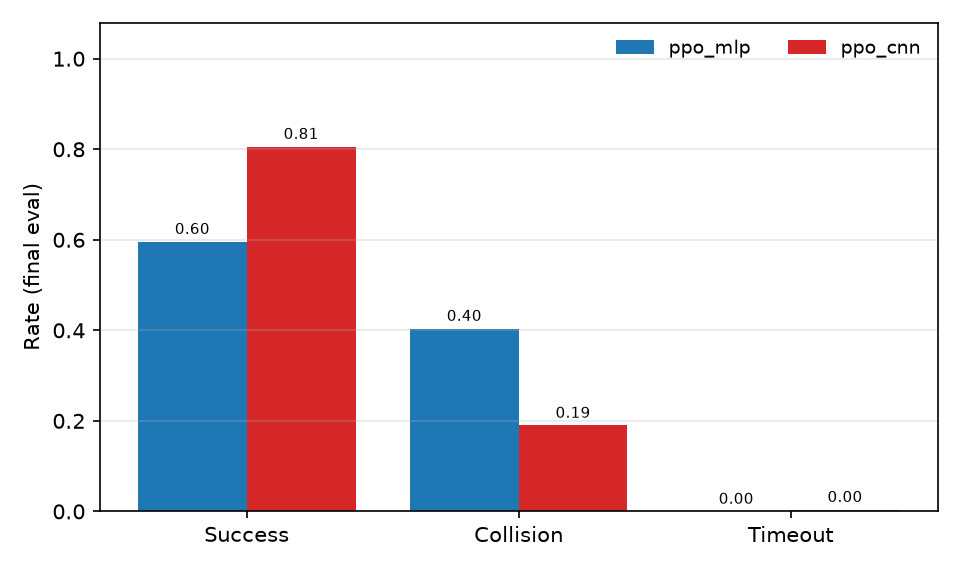
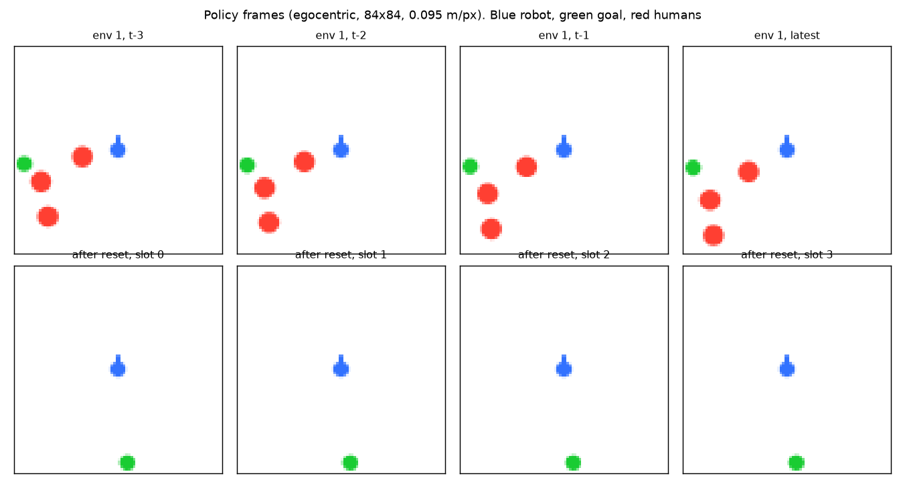
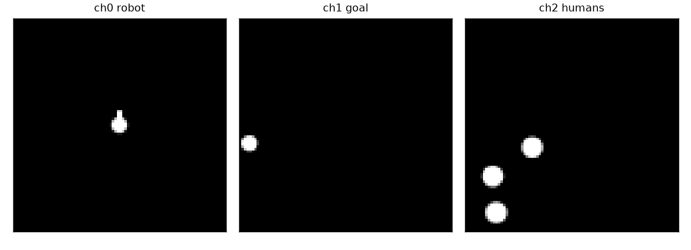

# Task 002: Visual PPO for Crowd Navigation (`ppo_cnn`)

Branch: `visual-ppo` (JAX, built on `gnn-jax`). This branch adds `ppo_cnn`, a PPO policy whose actor sees **only the latest 4 clean top-down images**, and compares it with the state-based `ppo_mlp` in the 20-human unicycle setting.

**Headline:** in this seed-0 comparison, `ppo_cnn` reached 0.81 final eval success from images alone, compared with 0.60 for the state-based `ppo_mlp`, so the robot can learn to reach the goal and avoid obstacles from pixels.

## Contents

1. [Videos: same scenario, both policies](#videos-same-scenario-both-policies)
2. [Results](#results)
3. [Q1. Images](#q1-images)
4. [Q2. Frame history](#q2-frame-history)
5. [Q3. CNN](#q3-cnn)
6. [Q4. PPO changes](#q4-ppo-changes)
7. [Q5. Results and videos](#q5-results-and-videos)
8. [Reproduce](#reproduce)

## Videos: same scenario, both policies

Both policies start from the same scenario (eval seed **348**, final checkpoint, seed-0 training run). GIFs play at 2x speed. The `ppo_cnn` video has a right-hand panel with the exact 4 frames the CNN receives at each step (oldest to newest), and a dashed green square in the arena marking the CNN's 8 m x 8 m window.

Both videos here use the same scheme and start from the same scenario.

| `ppo_mlp` (state) | `ppo_cnn` (pixels) + what the CNN sees |
|---|---|
|  |  |
| Collision at about 6.6 s | Reaches the goal at about 9.2 s |

A walkthrough of these runs is in [Q5](#q5-results-and-videos).

## Results

### Learning curves (training seed 0)

| Success | Collision | Return |
|---|---|---|
|  |  |  |

In-training eval uses 20 episodes per point (standard error about ±0.09 near 0.8). The final comparison uses the larger `scripts/eval.py` evaluation below.

### Final evaluation (`scripts/eval.py`, 10 scenario seeds x 50 episodes)



| Model | Training seed | Checkpoint steps | Success | Collision | Timeout | Return | Travel time (s) | Closest dist (m) |
|---|---|---|---|---|---|---|---|---|
| ppo_mlp | 0 | 19.66M | 0.60 | 0.40 | 0.00 | 2.29 | 6.1 | 0.95 |
| ppo_cnn | 0 | 20.00M | 0.81 | 0.19 | 0.00 | 2.87 | 7.0 | 0.85 |

Each row is 500 episodes. With one training seed, these results do not show variation between seeds. Travel time and closest distance are over successful episodes only, so `ppo_mlp`'s larger closest distance does not mean it is safer overall: it collides about twice as often.

## Q1. Images

Code: [`env/jax_image_renderer.py`](env/jax_image_renderer.py) (`render_policy_frame`, `RenderConfig`). Config: `render:` block in [`config/model/ppo_cnn.yaml`](config/model/ppo_cnn.yaml).

| Property | Value |
|---|---|
| Size | 84 x 84 |
| Channels | 3 binary-style masks: 0 = robot disc + heading tick, 1 = goal, 2 = humans |
| Pixel range | stored as uint8 [0, 255], divided by 255 to [0, 1] in the model |
| View | egocentric: robot at the centre, heading up |
| Extent | ±4 m, an 8 m x 8 m window (0.095 m per pixel) |
| Visibility | a human is drawn only if its slot is active (`mask > 0.5`) and it overlaps the window. Inactive slots are never drawn |
| Goal outside the window | pulled onto the border along the robot-goal line, so it gives direction only |
| Drawing | anti-aliased discs at true radius; pure JAX, rendered inside the jitted rollout at every step |

The image contains no past trajectories, future states, safety regions, QP diagnostics, text or numbers.

**Sample frames** (from [`scripts/check_policy_images.py`](scripts/check_policy_images.py), shown in colour: robot blue, goal green, humans red):

| 4-frame stack the CNN receives | Channels of one frame |
|---|---|
|  |  |

**How forbidden information was checked to be absent** (`scripts/check_policy_images.py`, all pass):
- **No hidden-state leakage:** randomising human velocities, human goals, v_max, episode returns and other hidden state leaves the image bit-identical.
- **Masked humans are invisible:** inactive slots produce no pixels.
- **Geometry is right:** robot centred, heading tick points up, each human's pixel area ≈ πr².
- **Egocentric invariance:** a rigid transform of the whole world leaves the image unchanged.
- **Actor sees pixels only:** in [`model/jax_ppo_cnn.py`](model/jax_ppo_cnn.py) the actor path deletes `obs`. [`scripts/check_ppo_cnn.py`](scripts/check_ppo_cnn.py) checks that randomising `obs` leaves the action unchanged while changing the images changes it.

## Q2. Frame history

Code: `init_image_history`, `update_image_history`, `history_to_cnn_input` in [`env/jax_image_renderer.py`](env/jax_image_renderer.py); wiring in [`trainer/jax_ppo_rollout.py`](trainer/jax_ppo_rollout.py) and [`trainer/jax_ppo_eval.py`](trainer/jax_ppo_eval.py).

| Where | Shape | dtype |
|---|---|---|
| Image history in the env state | `(num_envs, T=4, 84, 84, 3)` | uint8 |
| CNN input | `(batch, 84, 84, 12)`, channels ordered t0c0, t0c1, t0c2, t1c0, ... | float32 in [0, 1] |
| PPO rollout batch (`batch["img"]`) | `(steps x envs, 4, 84, 84, 3)` | uint8 (~350 MB for 4,096 samples) |

- **Episode start:** all 4 slots hold copies of the first frame.
- **Every step:** shift oldest to newest and append the new frame.
- **Reset:** the image is rendered after done envs are reset. For any env that reset, all 4 slots are overwritten with the new episode's first frame, so no frame from the old episode survives. This uses the same `done` flag as the vector history.
- **Eval:** the same history runs inside the eval loop and is frozen after an episode ends.

**Evidence:** history order and reset tests in `scripts/check_policy_images.py`, and [`scripts/check_image_wiring.py`](scripts/check_image_wiring.py), which runs rollout → batch → PPO update → eval and checks that frames shift in order between steps and that the history is cleared at every reset in the rollout.

## Q3. CNN

Code: [`model/jax_ppo_cnn.py`](model/jax_ppo_cnn.py), registered as `ppo_cnn` in [`model/__init__.py`](model/__init__.py). The trunk follows CleanRL's `ppo_atari` (Nature DQN).

```
input          84 x 84 x 12   (4 frames x 3 channels)
conv 8x8, s4   → 20 x 20 x 32   ReLU
conv 4x4, s2   →  9 x  9 x 64   ReLU
conv 3x3, s1   →  7 x  7 x 64   ReLU
flatten        → 3136
linear         → 512 latent     ReLU

actor   512 → 256 → 256 → 2   pre-tanh mean, + learned log-std (2)
critic  512 → 256 → 256 → 1   value (shares the CNN trunk)
```

| Part | Params |
|---|---|
| CNN trunk | 1,700,512 |
| Actor head | 197,636 |
| Critic head | 197,377 |
| Total | 2,095,529 |

- **Actor:** receives the image stack only. Outputs the pre-tanh Gaussian mean and std; the action is squashed exactly as in `ppo_mlp`.
- **Critic:** by default receives the same CNN latent and outputs the value. An optional asymmetric state critic (`critic.input: state`, on the `ppo_mlp` features) exists but was off in this run.
- Conv layers use `lax.conv_general_dilated` (NHWC). Linear layers use a plain matmul. Everything stays float32 even though the trainer enables x64.

## Q4. PPO changes

- **Reward:** unchanged (same as `ppo_mlp`: +20 success, -20 collision, progress, discomfort, spin, reverse and boundary terms).
- **Action bounds:** unchanged. Same tanh-squashed Gaussian: v ∈ [-1.5, 1.5] m/s, ω ∈ [-1.57, 1.57] rad/s. `check_ppo_cnn.py` confirms the bounds.
- **Hyperparameters:** identical to `ppo_mlp`: 20M configured steps, 128 envs, 4,096 steps per batch, 4 epochs, 32 minibatches, lr 1e-4 linear decay, γ 0.99, λ 0.98, clip 0.2, entropy 0.01, target KL 0.02, max grad norm 0.5, `vf_coef` 0.5.
- **Shared trunk:** actor and critic share the CNN, as in CleanRL. The combined loss uses `vf_coef` 0.5.
- **Trainer plumbing:** images are rendered inside the rollout, stored as uint8, passed to the loss as `image_obs`, and minibatched with the other batch keys. Models without a `render:` config are unaffected (`check_image_wiring.py` compares the `ppo_mlp` rollout and eval with the `gnn-jax` code, and they are bit-identical on a short regression test).
- **Eval speed-up:** `scripts/eval.py` now compiles the eval loop once and reuses it, and `--visualize` runs each episode as one jitted scan (455 s → 25 s per episode on CPU). On the checkpoints tested, success, collision and timeout rates were unchanged and returns matched to 7 digits.

## Q5. Results and videos

Results are in [Results](#results); videos are at the [top](#videos-same-scenario-both-policies).

**Settings.** 20 humans, unicycle, settings as in [Q4](#q4-ppo-changes). Training seed 0 for both models. `ppo_cnn` uses an 8 m x 8 m image window (`half_extent: 4.0`).

**Video walkthrough (seed 348).** Both robots start near (-1.8, -5.7) with the goal near (5, 4.4). Positions below are approximate and read from the videos.

- **`ppo_mlp` (collision):** it curls around the start, then drives almost straight at the goal. It passes through the middle of the crowd, reaches about (2.2, 2.0) at 6.6 s and collides with the human on its right, near (2.9, 1.9).
- **`ppo_cnn` (success):** it starts facing away from the goal, so the goal first appears at the bottom of the image, clipped to the border. That gives direction but no distance. It turns until the goal is near the top of the image, then moves through the crowd. By about 7 s the goal is inside the window. Near (1.7, 2.6) it keeps heading up past the humans on its right instead of cutting straight across them, then curves right and reaches the goal at about 9.2 s.
- **Difference:** in this scenario, `ppo_cnn` takes a longer path and arrives later, but avoids the contact that ends the `ppo_mlp` episode. This matches the final evaluation, where its successful episodes take longer on average (7.0 s against 6.1 s) and it collides less often.
- **What the CNN sees:** at the start, the panel shows only the few humans within ±4 m. The crowd fills the window between about 5 s and 8 s, and neighbouring humans can touch in the image. Neither robot shows a boundary excursion in this episode.


## Reproduce

```bash
# checks (images, wiring, model)
python scripts/check_policy_images.py --extent 4
python scripts/check_image_wiring.py
python scripts/check_ppo_cnn.py
python scripts/check_ppo_cnn.py --critic state

# train both models, seed 0 (the ppo_cnn config uses half_extent: 4.0)
for m in ppo_mlp ppo_cnn; do
  WANDB_MODE=offline RUN_NAME=${m}_s0 bash scripts/run_ppo.sh model=${m} seed=0; done

# final metrics, once per run (writes eval_results.json)
python scripts/eval.py --save-dir <run_dir> --checkpoint <run_dir>/ckpt_<last>.pkl

# videos for the README seed (--policy-view only for ppo_cnn)
python scripts/eval.py --save-dir <ppo_mlp_dir> --checkpoint <ppo_mlp_dir>/ckpt_<last>.pkl \
  --visualize --seeds 348 --episodes 1
python scripts/eval.py --save-dir <ppo_cnn_dir> --checkpoint <ppo_cnn_dir>/ckpt_<last>.pkl \
  --visualize --policy-view --seeds 348 --episodes 1

```

Install, W&B logging and general options are the same as the base JAX branch: see the `main_jax` README of the [original repo](https://github.com/anonymousrobotics9666/Reinforcement-Learning-Adaptive-CVaR-Barrier-Function).
