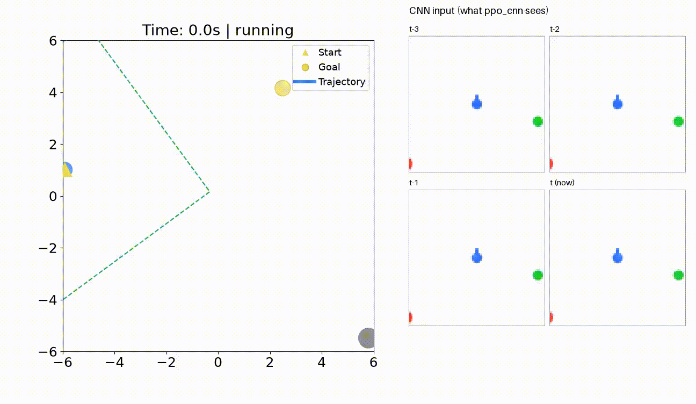
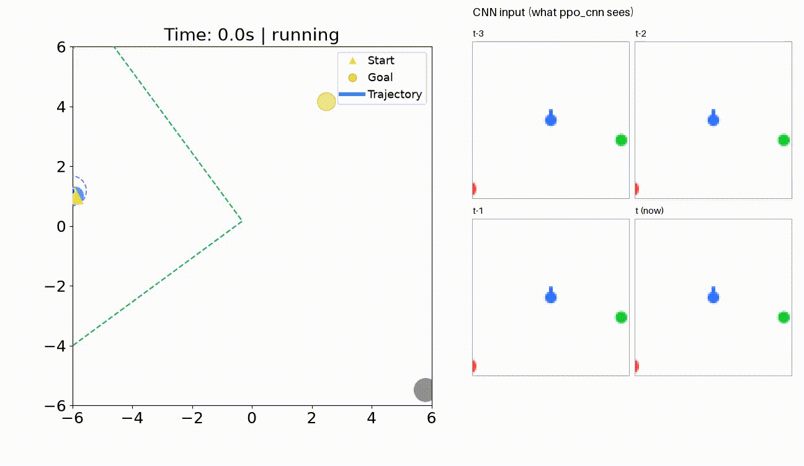
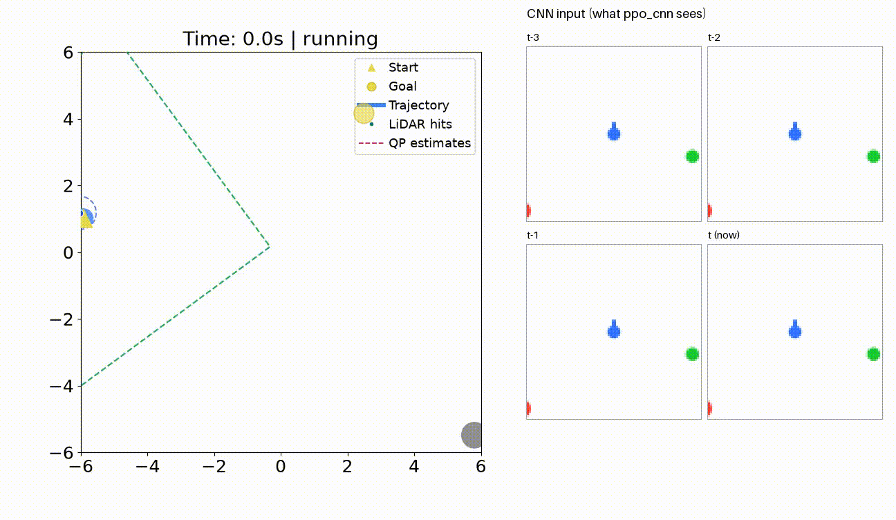
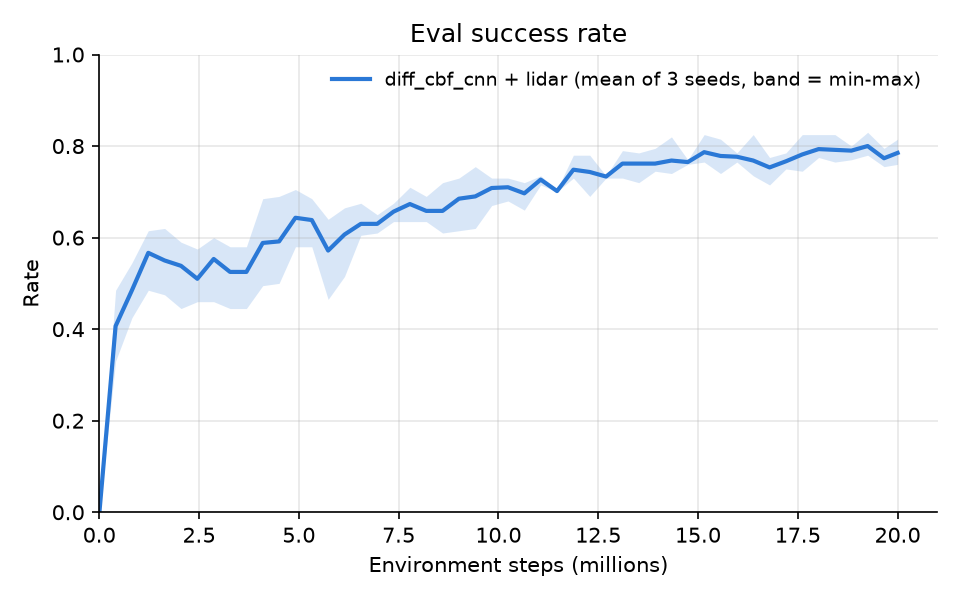
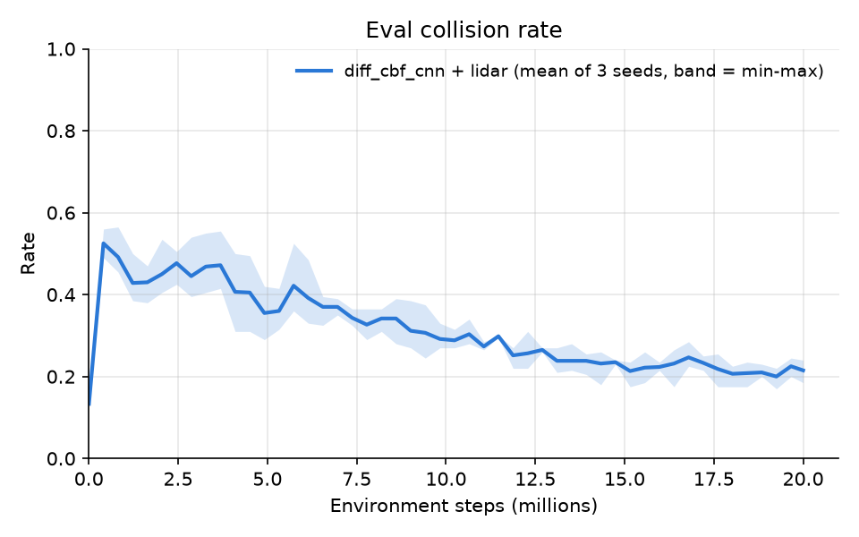
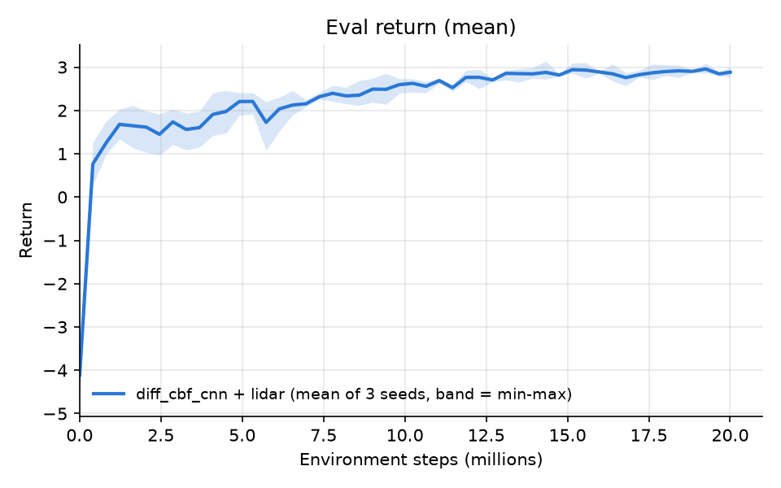
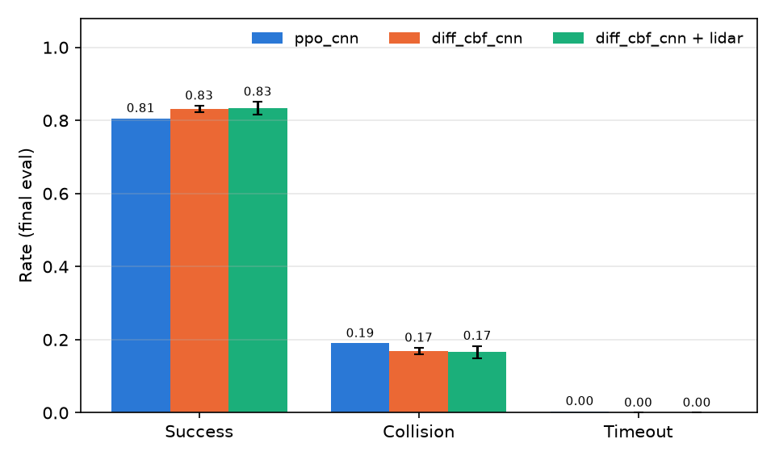
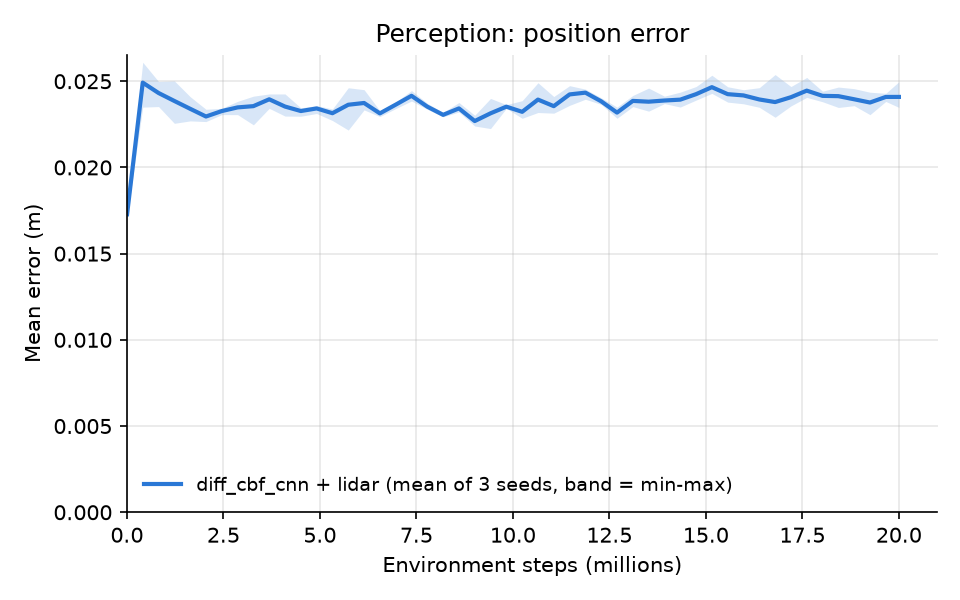
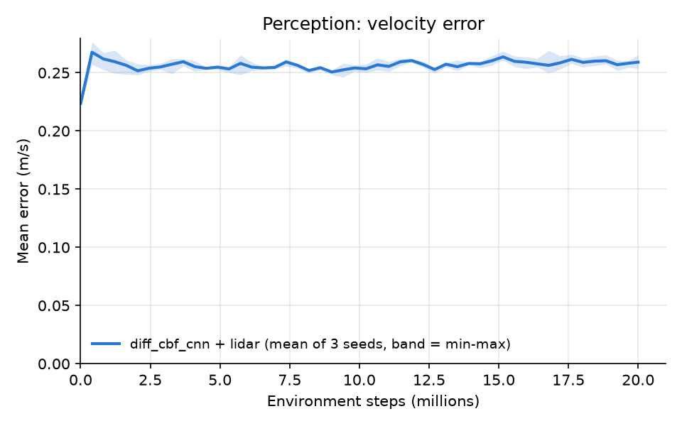

# Task 003: Visual PPO with a Differentiable CBF-QP Layer (`barriernet_cnn`)

Branch: `barriernet-cbf` (JAX, built on `visual-ppo`). This branch replaces the CVaR barrier constraints with plain, BarrierNet-style CBF constraints and a learned per-obstacle gain κ. It then puts that QP behind the image policy from Task 002. The CNN still sees only images. The QP gets obstacle geometry, first from ground truth and then from a simulated 2D LiDAR with a Kalman tracker.

Naming: the task's `barriernet_cnn` is `diff_cbf_cnn` in the code. "+ lidar" means the same model with `model.geometry=lidar`.

| Step in the task | Model | Code |
|---|---|---|
| 1. Differentiable CBF-QP | `diff_cbf_gnn` | [`model/jax_cbf_qp.py`](model/jax_cbf_qp.py), [`model/jax_diff_cbf_gnn.py`](model/jax_diff_cbf_gnn.py) |
| 2. CNN + CBF-QP, ground-truth geometry | `diff_cbf_cnn` | [`model/jax_diff_cbf_cnn.py`](model/jax_diff_cbf_cnn.py) |
| 3. CNN + CBF-QP, LiDAR geometry | `diff_cbf_cnn` + `geometry=lidar` | [`env/jax_lidar.py`](env/jax_lidar.py), [`env/jax_tracker.py`](env/jax_tracker.py) |
| 4. Comparison with `ppo_cnn` | all of the above | [Results](#results) |

**Headline:** with LiDAR geometry, `diff_cbf_cnn` reaches about 0.79 in-training eval success and 0.21 collision at 20M steps (mean of 3 seeds).

## Contents

1. [Videos: same scenario, three policies](#videos-same-scenario-three-policies)
2. [Results](#results)
3. [Q1. CBF-QP: what changed from CVaR-BF](#q1-cbf-qp-what-changed-from-cvar-bf)
4. [Q2. Inputs](#q2-inputs)
5. [Q3. Geometry](#q3-geometry)
6. [Q4. Results and videos](#q4-results-and-videos)
7. [Reproduce](#reproduce)

## Videos: same scenario, three policies

All policies start from the same scenario (eval seed **312**, final checkpoint, seed-0 training run). In the LiDAR video, small teal dots are the scan hits and dashed pink circles are the estimates the QP uses.

| `ppo_cnn` | `diff_cbf_cnn` (ground truth) | `diff_cbf_cnn` + lidar |
|---|---|---|
|  |  |  |
| Collision at 6.4 s| Goal at 7.4 s | Goal at 7.6 s |

A walkthrough of these runs is in [Q4](#q4-results-and-videos).

## Results

### Learning curves (3 seeds, mean line, min to max band)

| Success | Collision | Return |
|---|---|---|
|  |  |  |

In-training eval uses 20 episodes per point, so each point has a standard error of about ±0.09 near 0.8. The final comparison below uses the larger `scripts/eval.py` evaluation.

### Final evaluation (`scripts/eval.py`, latest surviving checkpoint, 10 scenario seeds x 50 episodes)



**1) `barriernet_cnn` vs `ppo_cnn`**

| Model | Seeds | Success | Collision | Timeout | Return | Travel time (s) | Closest dist (m) |
|---|---|---|---|---|---|---|---|
| ppo_cnn | 1 | 0.81 | 0.19 | 0.00 | 2.87 | 7.0 | 0.85 |
| diff_cbf_cnn | 3 | 0.83 ± 0.01 | 0.17 ± 0.01 | 0.00 ± 0.00 | 3.13 ± 0.04 | 8.3 ± 0.3 | 0.64 ± 0.01 |
| diff_cbf_cnn + lidar | 3 | 0.83 ± 0.02 | 0.17 ± 0.02 | 0.00 ± 0.00 | 3.08 ± 0.06 | 8.6 ± 0.1 | 0.65 ± 0.02 |

**2) Ground-truth geometry vs sensor geometry**

| Model | Seeds | Success | Collision | Timeout | Return | Travel time (s) | Closest dist (m) |
|---|---|---|---|---|---|---|---|
| diff_cbf_cnn | 3 | 0.83 ± 0.01 | 0.17 ± 0.01 | 0.00 ± 0.00 | 3.13 ± 0.04 | 8.3 ± 0.3 | 0.64 ± 0.01 |
| diff_cbf_cnn + lidar | 3 | 0.83 ± 0.02 | 0.17 ± 0.02 | 0.00 ± 0.00 | 3.08 ± 0.06 | 8.6 ± 0.1 | 0.65 ± 0.02 |

**3) Step 1 check: `diff_cbf_gnn` vs `diff_cvar_gnn`**

| Model | Seeds | Success | Collision | Timeout | Return | Travel time (s) | Closest dist (m) |
|---|---|---|---|---|---|---|---|
| diff_cvar_gnn (from Task 001) | 3 | 0.93 ± 0.02 | 0.07 ± 0.02 | 0.00 ± 0.00 | 3.30 ± 0.07 | 12.0 ± 0.2 | 0.75 ± 0.01 |
| diff_cbf_gnn | 3 | 0.90 ± 0.01 | 0.09 ± 0.01 | 0.00 ± 0.00 | 3.44 ± 0.04 | 9.2 ± 0.4 | 0.59 ± 0.01 |

Values are mean ± std over training seeds. Travel time and closest distance are over successful episodes only. Closest distance is the smallest clearance between the robot and human surfaces in an episode.


## Q1. CBF-QP: what changed from CVaR-BF

Code: [`model/jax_cbf_qp.py`](model/jax_cbf_qp.py) (QP), [`model/jax_diff_cbf_gnn.py`](model/jax_diff_cbf_gnn.py) (GNN actor). Config: [`config/model/diff_cbf_gnn.yaml`](config/model/diff_cbf_gnn.yaml).

Following [BarrierNet, Section 5, Eq. (6) to (10)](https://arxiv.org/html/2111.11277), the network learns the **nominal action** and a **positive CBF gain κᵢ per obstacle**. The constraint for obstacle i is

```
h_i      = ||q - p_i||² - R_i²                      q = lookahead point 0.2 m ahead of the robot
ḣ_i      = L_g h_i · u  -  2 (q - p_i) · v_i        constant-velocity obstacle
row      ḣ_i + κ_i h_i ≥ -s_i                       s_i ≥ 0, one slack per obstacle
κ_i      = κ_min + (κ_max - κ_min) σ(ξ_i)           κ ∈ [0.5, 5.0], starts at 2.0
```

| | CVaR-BF (`diff_cvar_gnn`) | CBF (`diff_cbf_gnn`) |
|---|---|---|
| Obstacle motion | 3-component GMM over velocity (weights 0.6/0.2/0.2) | one constant velocity |
| Worst case | logsumexp (τ = 0.1) over the 3 GMM rows | none |
| Risk tightening | `σ_f · c(β)`, β learned per human (budget 0.5 over top 5) | none, no β |
| Class-K gain | fixed α = 2.0 | learned κᵢ per obstacle, ∈ [0.5, 5.0] |
| Safe radius | learned per human, `r_robot + r_human + 0.05 + 1.125·σ` ∈ [0.75, 1.875] | fixed `R = r_robot + r_human + 0.05 = 0.75` m |
| Learned per obstacle | β, r_safe | κ |

**Kept exactly as in `diff_cvar_mlp` / `diff_cvar_gnn`:** nearest-K selection (K = 5, Euclidean distance on the current frame), validity masks (inactive rows are all zero), one slack per row with weight 10, box bounds v ∈ [-1.5, 1.5], ω ∈ [-1.57, 1.57], the lookahead unicycle model, all rows in one QP, the same `jax_qpth` solver with implicit (KKT) differentiation in float64, the GAT encoder and the PPO trainer.

**Design choices.**
- `κ_max = 5` stays well below `1/dt = 10`, so one step cannot jump over the boundary.
- `κ_init = 2.0` equals the old fixed α. The head bias is set so every κ starts there.
- The κ head is per human, like the β and r_safe heads of `diff_cvar_gnn`: input `[latent(16), human node state(64), latest human→robot edge(5)] = 85 → 256 → 1`. So κ is permutation equivariant over human slots.
- κ is logged under the trainer's existing `alpha` key.

**Parameters:** `diff_cbf_gnn` 282,333 (GAT 118,995, actor 211,928, critic 70,401), vs 282,596 for `diff_cvar_gnn`.


## Q2. Inputs

Code: [`model/jax_diff_cbf_cnn.py`](model/jax_diff_cbf_cnn.py). Config: [`config/model/diff_cbf_cnn.yaml`](config/model/diff_cbf_cnn.yaml).

```
image history (4 x 84 x 84 x 3) ─► CNN ─► latent (512) ─► nominal head ─► nominal action ─┐
                                              └─────────► κ head ──────► κ (5) ───────────┤
                                                                                           ▼
true sensor state ─► geometry (ground truth | LiDAR + tracker) ─► top-5 humans ─► CBF-QP ─► u*
                                                                  u* ─► Gaussian sample ─► tanh ─► env action
```

| Part | Receives | Ground truth? |
|---|---|---|
| CNN actor (nominal action) | the last 4 top-down images, 84 x 84, egocentric, ±4 m (same renderer and settings as `ppo_cnn`) | No state. The images are rendered from the simulator, as in Task 002 |
| κ head | the CNN latent only: `512 → 256 → 5`. Row j is the j-th nearest human, because the QP rows are sorted by distance | No |
| Critic | the shared CNN latent (`critic.input: image`, default) | No |
| QP, robot block | goal offset, robot velocity, heading, robot radius | **Yes**, in both modes (true robot state) |
| QP, humans (ground-truth mode) | top-5 true relative positions, velocities, radii, masks | **Yes** |
| QP, humans (LiDAR mode) | top-5 tracker estimates: position, velocity, known radius 0.4 m, track mask | No direct ground truth (see [Q3](#q3-geometry)) |
| QP, safe radius R | `r_robot + r_human + 0.05` (0.75 m) | constants |

**CNN + κ head.** Same Nature-DQN trunk as `ppo_cnn` (84 → 20 → 9 → 7, flatten 3,136, linear 512). The image does not say which slot is which, so a per-slot κ head (as in the GNN) is not possible. A head with one output per QP row works because the QP rows are always ordered nearest first.

**Parameters:** CNN 1,700,512, actor 2,030,761 (incl. CNN), critic 197,377, total 2,228,138 (`ppo_cnn`: 2,095,529).


## Q3. Geometry

**Ground truth** (`model.geometry: ground_truth`, default). The QP reads the current frame of the env's vector observation: `[robot - human, human velocity, radius, mask]` for all 20 slots, and picks the 5 nearest.

**Estimated from a simulated 2D LiDAR** (`model.geometry: lidar`). Code: [`env/jax_lidar.py`](env/jax_lidar.py), [`env/jax_tracker.py`](env/jax_tracker.py). Everything is pure JAX, jitted inside the rollout and eval loops. The design follows `obstacle_detector` (scan → segments → circles → Kalman tracking) and SORT.

| Stage | What it does | Settings |
|---|---|---|
| 1. Scan | ray-circle intersection with every active human; each beam keeps its nearest hit, so occlusion is automatic | 360 beams, 360°, 12 m range. Training runs: range noise 0.02 m, dropout 1% |
| 2. Points | ranges → world-frame points using the robot pose. **This removes the robot's own motion** | |
| 3. Segment | consecutive hits split at range jumps: gap < `0.15 + 3·r·Δθ`. The cluster across the 0/360° seam is merged | up to 32 clusters |
| 4. Circle fit | damped Gauss-Newton fit of a circle with the known radius, started one radius behind the centroid | 6 iterations |
| 5. Track | constant-velocity Kalman filter per slot in the world frame; greedy nearest-neighbour association | gate 1.0 m, accel std 3 m/s², meas std 0.05 m, new tracks start at v = 0 (std 1.5 m/s), coast 3 steps, reset at episode end |
| 6. QP frame | same layout as the ground-truth frame: `[robot - track position, track velocity, 0.4, track mask]` | 20 track slots |

**Velocities** come only from the Kalman state. Because tracking runs in the world frame, the estimate is the obstacle's own velocity, not velocity relative to the moving robot.

**Ground truth still used in LiDAR mode:** the scan is simulated from the true human positions (that is the sensor model); the robot pose and robot block are true (perfect odometry); the circle fit assumes the true human radius. Perception errors against ground truth are logged under `perception/*` but never reach the policy or the QP. A `tracked_truth` mode (true centres + 0.02 m noise, skipping the scan) exists to isolate the tracker.


**Perception during training (LiDAR runs, humans within 4 m of the robot):**

| Position error | Velocity error |
|---|---|
|  |  |

## Q4. Results and videos

Results are in [Results](#results); videos are at the [top](#videos-same-scenario-three-policies).

**Settings (all CNN runs).** 20 humans, unicycle, 20M steps, 128 envs, 4,096 steps per batch, 4 epochs, 32 minibatches, lr 1e-4 with linear decay, γ 0.99, λ 0.98, clip 0.2, entropy 0.01, target KL 0.02, max grad norm 0.5, normalized advantages. Images: 84 x 84, 4 frames, ±4 m egocentric window. Same reward, action bounds and tanh-squashed Gaussian as `ppo_cnn`. The QP models add the existing slack penalty `0.05 · mean slack` to the training reward, as `diff_cvar_*` did. Training seeds 0, 1, 2.

**Checkpoints.** Stored under `outputs/crowd_dyn_var_num_env/runs/<run>_s<seed>-<model>-bs4096-ep4-lr1.0e-04-ent0.01-braxppo/`:


**Video walkthrough (seed 312).** The robot starts at about (-6, 1) with the goal at about (2.5, 4.2). Humans keep entering the arena: one is visible at the start and about 20 by 5 s, and most of them gather in the middle and lower half. Positions below are approximate and read from the videos.
 
- **`ppo_cnn` (collision):** for the first 3 s it curves up and right, like the other two. At about (-2.7, 2.2) it turns right, away from the goal, and heads south-east into the middle of the arena. By 5 s the goal sits at the left edge of its image, clipped to the border, so the CNN has direction but no distance. By 6 s the robot is near (0, 0) with the goal behind it, and the crowd fills the whole window on every side. At 6.4 s it hits the human on its right, near (0.7, -0.5), still about 5 m from the goal.
- **`diff_cbf_cnn`, ground truth (success):** it keeps climbing north instead of turning right: (-3.3, 3.3) at 3 s, (-2.2, 4.3) at 4 s. It then runs east along y ≈ 4.8, above the humans near (-1.1, 3.6) and (2.3, 3.6), so the crowd stays below it. Around 4.9 s a human passes over the goal (in the panel, the goal and a red human overlap and are drawn dark) and then moves down and away. It does not slow down noticeably and reaches the goal at 7.4 s.
- **`diff_cbf_cnn` + lidar (success):** almost the same path as with ground truth, about 0.2 s behind at each point, and it reaches the goal at 7.6 s. The pink estimates sit on the true humans and follow them as they move, and they are only drawn for the 5 nearest. Scan hits only cover the side of each human that faces the robot, and humans hidden behind others get few or no hits. Near the end, two of the humans each carry two estimates about 0.1 m apart (a duplicate track). Those humans are more than 2 m away, so the extra QP rows do not change the action here, but a duplicate does use up one of the 5 QP slots.
- **Difference:** the two QP policies pick the northern route along the top of the arena and never enter the crowd. `ppo_cnn` turns into the area where the crowd is gathering and gets boxed in. The ground-truth and LiDAR versions of `diff_cbf_cnn` behave almost the same, which matches the small perception errors in [Q3](#q3-geometry).


## Reproduce

```bash

# train, seeds 0 1 2
for s in 0 1 2; do
  RUN_NAME=diff_cbf_gnn_s${s} bash scripts/run_ppo.sh model=diff_cbf_gnn seed=${s}
  RUN_NAME=diff_cbf_cnn_s${s} bash scripts/run_ppo.sh model=diff_cbf_cnn seed=${s}
  RUN_NAME=lidar_diff_cbf_cnn_s${s} bash scripts/run_ppo.sh model=diff_cbf_cnn seed=${s} \
    model.geometry=lidar model.lidar.range_noise_std=0.02 model.lidar.dropout_prob=0.01
done

# final metrics on the latest surviving checkpoint of each run (writes eval_results.json)
python scripts/eval.py --save-dir <run_dir> --checkpoint <run_dir>/ckpt_<last>.pkl

# video for the README seed (add --policy-view to see the CNN input)
python scripts/eval.py --save-dir <run_dir> --checkpoint <run_dir>/ckpt_<last>.pkl \
  --visualize 

```

Install, W&B logging and general options are the same as the base JAX branch: see the `main_jax` README of the [original repo](https://github.com/anonymousrobotics9666/Reinforcement-Learning-Adaptive-CVaR-Barrier-Function).
